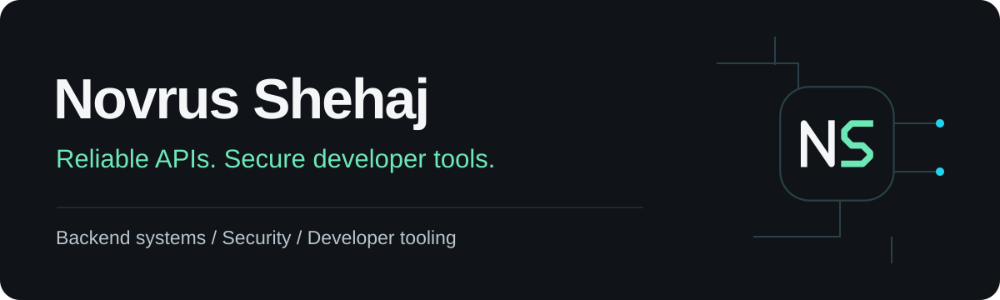

<picture>
  <source media="(prefers-color-scheme: light)" srcset="./assets/header-light.svg" />
  
</picture>

# Hi, I'm Novrus

I build backend services, security infrastructure, and developer tools.
I'm an **Application Developer at UConn Health's Center for Cell Analysis and
Modeling**, contributing to BioSimulations and Virtual Cell.

[LinkedIn](https://www.linkedin.com/in/novrus-shehaj) ·
[Email](mailto:Novrus.Shehaj@icloud.com) ·
[Repositories](https://github.com/NovrusShehaj?tab=repositories)

## About me

- Based in **Connecticut, United States**.
- **B.S. in Computer Science**, Cybersecurity concentration, University of Connecticut.
- Experience across software development, IT operations, and automation.
- Interested in **software engineering and security opportunities**, including remote work.

I enjoy making complex systems easier to use: reliable APIs, clear authorization
rules, and tools that help developers get their work done.

## Selected work

### BioSimulations Platform

**Professional contribution · Backend and security**

Backend services for running and verifying reproducible biological simulations.
My work includes Auth0/OIDC authentication, JWT validation with a resilient JWKS
cache, and composable role-based authorization.

`Python` `FastAPI` `Auth0 / OIDC` `Kubernetes`

[Explore the platform](https://github.com/biosimulations/platform)

### Compose API

**Professional contribution · Developer tooling**

A command-line client for biological workflows and co-simulations. My work
includes browser PKCE sign-in, an SSH-friendly device flow, and sessions stored
in the operating system's keychain.

`Python` `FastAPI` `OAuth` `CLI tooling`

[Explore Compose API](https://github.com/biosimulations/compose-api)

### EdgeAI Sentinel

**Personal project · Inference and monitoring**

An object-detection pipeline spanning YOLOv8 training, ONNX export, a token-secured
inference API, and operational monitoring.

`YOLOv8` `ONNX` `FastAPI` `Docker` `Prometheus`

[Explore EdgeAI Sentinel](https://github.com/NovrusShehaj/EdgeAI-Sentinel)

## Technologies I work with

**Backend:** Python, FastAPI, Node.js, SQL  
**Frontend:** JavaScript, React, HTML, CSS, Tailwind CSS  
**Security:** OAuth/OIDC, JWT validation, role-based access control  
**Infrastructure and tools:** Git, Docker, Linux, Kubernetes, PowerShell

## Let's connect

Interested in my work or a potential role? I'd be happy to talk.

[Connect on LinkedIn](https://www.linkedin.com/in/novrus-shehaj) ·
[Send an email](mailto:Novrus.Shehaj@icloud.com)
