<!--
╔═════════════════════════════════════════════════════════════╗
║                                                             ║
║    ███╗   ██╗ ██████╗ ██╗   ██╗██████╗ ██╗   ██╗███████╗    ║
║    ████╗  ██║██╔═══██╗██║   ██║██╔══██╗██║   ██║██╔════╝    ║
║    ██╔██╗ ██║██║   ██║██║   ██║██████╔╝██║   ██║███████╗    ║
║    ██║╚██╗██║██║   ██║╚██╗ ██╔╝██╔══██╗██║   ██║╚════██║    ║
║    ██║ ╚████║╚██████╔╝ ╚████╔╝ ██║  ██║╚██████╔╝███████║    ║
║    ╚═╝  ╚═══╝ ╚═════╝   ╚═══╝  ╚═╝  ╚═╝ ╚═════╝ ╚══════╝    ║
║                                                             ║
║      BACKEND • SECURITY & IDENTITY • DEVELOPER TOOLING      ║
║                                                             ║
╚═════════════════════════════════════════════════════════════╝

  Content + colors live in profile.toml.
  ./assets/*.svg  → python3 scripts/build_assets.py
  live stat cards → .github/workflows/profile-metrics.yml (daily → `output` branch)
-->

<div align="center">

  <!-- ═══════════════════════════ 🎯 ANIMATED HEADER ═══════════════════════════ -->

  

  <br/>

  <!-- ═══════════════════════════ 📊 PROFILE BADGES ════════════════════════════ -->

  <a href="https://github.com/NovrusShehaj">
    
  </a>
  <a href="https://github.com/NovrusShehaj?tab=repositories">
    
  </a>
  <a href="https://github.com/NovrusShehaj?tab=followers">
    
  </a>
  
  <a href="https://www.linkedin.com/in/novrus-shehaj">
    
  </a>

</div>

<br/>

<!-- ═══════════════════════════ 🖥️ TERMINAL INTRO ═══════════════════════════════ -->

<div align="center">
  
</div>

<br/>


<br/>

<!-- ═══════════════════════════ 👤 ABOUT ME ═════════════════════════════════════ -->


I build backend services, security infrastructure, and developer tools. I'm an **Application Developer at
UConn Health's Center for Cell Analysis and Modeling**, contributing to **BioSimulations** and **Virtual Cell**.
I enjoy making complex systems easier to use: reliable APIs, clear authorization rules, and tools that help
developers get their work done.

<table>
<tr>
<td width="55%" valign="top">

### 🎯 What I Do

```yaml
name: Novrus Shehaj
role: Application Developer
org: UConn Health · Cell Analysis & Modeling
based_in: Connecticut, USA 🇺🇸
education: B.S. CS (Cybersecurity), UConn '25

what_i_do:
  - 🔐 Auth & identity (OIDC, JWT, RBAC)
  - ⚙️ Backend services & APIs
  - 🧬 Reproducible-science platforms
  - 🛠️ Developer tooling & CLIs
  - 🤖 Applied AI & edge inference

recent_work:
  - OIDC sign-in + RBAC for BioSimulations
  - PKCE & device-flow login, Compose API
  - Terminal-first workspaces (PineVim)

philosophy: "Easy to use. Hard to break."
```

</td>
<td width="45%" valign="top">

### 🚀 Current Focus

- 🔐 **Securing** research platforms with OIDC, JWT & RBAC
- ⚙️ **Building** reliable backend APIs in Python & FastAPI
- 🛠️ **Shipping** CLIs and tools developers enjoy using
- 🤖 **Exploring** edge AI and security-focused LLMs
- 🌱 **Contributing** to open-source scientific software

<br/>

### 💡 Quick Facts

- 🎓 UConn CS grad — cybersecurity concentration
- 💼 Experience across software, IT operations & automation
- 🐧 Daily-drives Arch Linux + Hyprland
- ⌨️ Lives in Neovim + tmux
- 📬 Open to SWE & security roles, including remote

</td>
</tr>
</table>

<br/>


<br/>

<!-- ═══════════════════════════ 🧩 FEATURED WORK ════════════════════════════════ -->

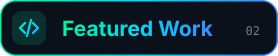

<div align="center">
  <a href="https://github.com/biosimulations/platform"></a>
  <a href="https://github.com/biosimulations/compose-api"></a>
  <a href="https://github.com/NovrusShehaj/EdgeAI-Sentinel"></a>
  <a href="https://github.com/NovrusShehaj/Gemma4-CyberAi"></a>
  <a href="https://github.com/NovrusShehaj/endpoint-automation"></a>
  <a href="https://github.com/NovrusShehaj/PineVim"></a>
</div>

<br/>


<br/>

<!-- ═══════════════════════════ 🏆 ACHIEVEMENTS ═════════════════════════════════ -->

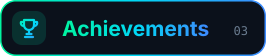

<div align="center">
  
</div>

<br/>


<br/>

<!-- ═══════════════════════════ 📊 GITHUB ANALYTICS ═════════════════════════════ -->

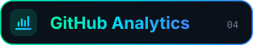

<div align="center">
  
  
  
  
  <br/>
  
</div>

<br/>


<br/>

<!-- ═══════════════════════════ 🐍 CONTRIBUTION SNAKE ═══════════════════════════ -->

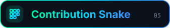

<div align="center">
  <picture>
    <source media="(prefers-color-scheme: dark)" srcset="https://raw.githubusercontent.com/NovrusShehaj/NovrusShehaj/output/snake-dark.svg"/>
    <source media="(prefers-color-scheme: light)" srcset="https://raw.githubusercontent.com/NovrusShehaj/NovrusShehaj/output/snake-light.svg"/>
    
  </picture>
  <br/>
  <sub>🐍 Every square is a day of shipping — regenerated daily from my contribution graph.</sub>
</div>

<br/>


<br/>

<!-- ═══════════════════════════ ⚡ TECH STACK ═══════════════════════════════════ -->

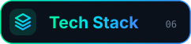

<div align="center">

<h4>💻 Languages</h4>
<p>
  <a href="https://www.python.org/"></a>
  <a href="https://www.typescriptlang.org/"></a>
  <a href="https://developer.mozilla.org/docs/Web/JavaScript"></a>
  <a href="https://isocpp.org/"></a>
  <a href="https://en.wikipedia.org/wiki/C_(programming_language)"></a>
  <a href="https://www.gnu.org/software/bash/"></a>
  <a href="https://learn.microsoft.com/powershell/"></a>
</p>

<h4>⚙️ Backend & Data</h4>
<p>
  <a href="https://fastapi.tiangolo.com/"></a>
  <a href="https://nodejs.org/"></a>
  <a href="https://www.postgresql.org/"></a>
  <a href="https://www.sqlite.org/"></a>
</p>

<h4>🔐 Security & Identity</h4>
<p>
  
  
  
  
  
</p>

<h4>🌐 Frontend</h4>
<p>
  <a href="https://react.dev/"></a>
  <a href="https://nextjs.org/"></a>
  <a href="https://tailwindcss.com/"></a>
  <a href="https://threejs.org/"></a>
  <a href="https://www.electronjs.org/"></a>
  <a href="https://developer.mozilla.org/docs/Web/HTML"></a>
  <a href="https://developer.mozilla.org/docs/Web/CSS"></a>
</p>

<h4>🤖 AI & Machine Learning</h4>
<p>
  <a href="https://pytorch.org/"></a>
  <a href="https://opencv.org/"></a>
  <br/>
  
  
  
  
</p>

<h4>🚢 DevOps & Infrastructure</h4>
<p>
  <a href="https://www.docker.com/"></a>
  <a href="https://kubernetes.io/"></a>
  <a href="https://prometheus.io/"></a>
  <a href="https://github.com/features/actions"></a>
  <a href="https://www.linux.org/"></a>
  <a href="https://archlinux.org/"></a>
</p>

<h4>🔧 Tools</h4>
<p>
  <a href="https://git-scm.com/"></a>
  <a href="https://github.com/"></a>
  <a href="https://neovim.io/"></a>
  <a href="https://code.visualstudio.com/"></a>
</p>

</div>

<br/>


<br/>

<!-- ═══════════════════════════ 🔥 BUILDING & LEARNING ══════════════════════════ -->

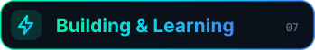

<div align="center">
  
  
  
  <br/>
  
  
</div>

<br/>


<br/>

<!-- ═══════════════════════════ 🌐 CONNECT ══════════════════════════════════════ -->

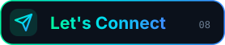

<div align="center">

Interested in my work or a potential role? I'd be happy to talk.

<br/>

<a href="https://www.linkedin.com/in/novrus-shehaj"></a>
<a href="mailto:Novrus.Shehaj@icloud.com"></a>
<a href="https://github.com/NovrusShehaj?tab=repositories"></a>

</div>

<br/>


<br/>

<!-- ═══════════════════════════ 💭 QUOTE OF THE DAY ═════════════════════════════ -->

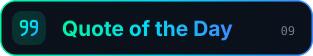

<div align="center">
  
</div>

<br/>

<!-- ═══════════════════════════ 🌊 FOOTER ═══════════════════════════════════════ -->

<div align="center">
  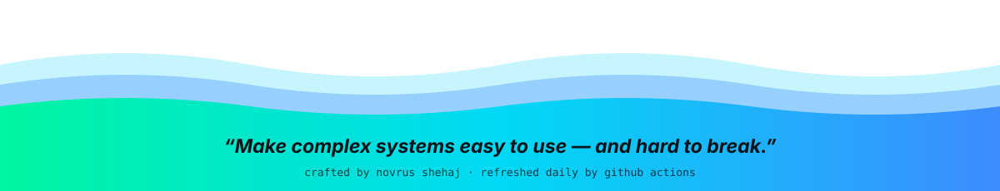
</div>
